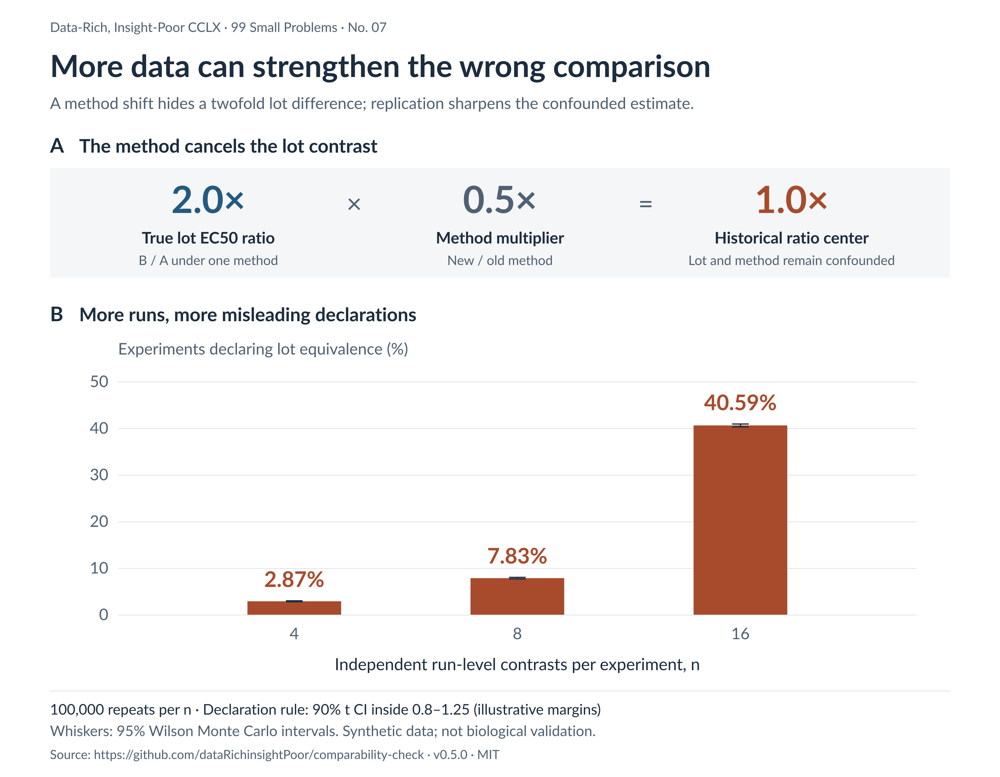
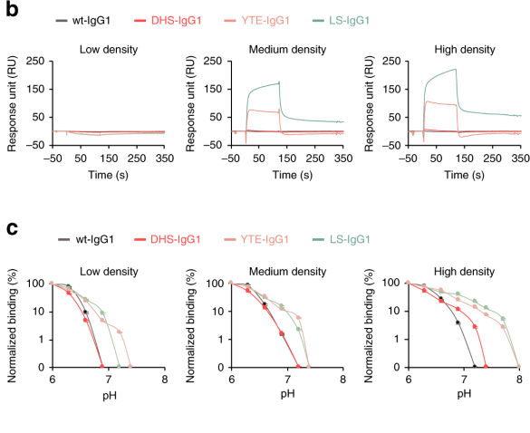
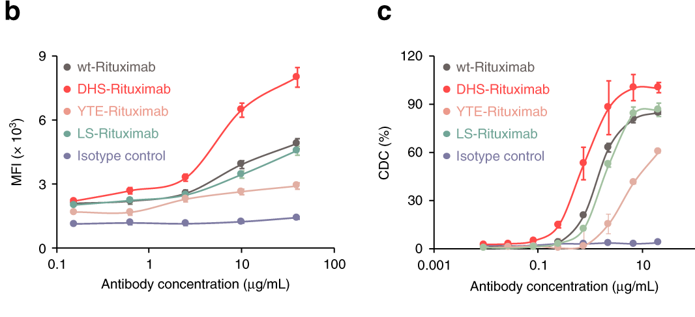

# To Be or Not to Be Comparable

Data-Rich, Insight-Poor CCLX · 99 Small Problems · No. 07

In the accompanying simulation, increasing the number of independent run-level contrasts from four to sixteen raises the frequency of a misleading historical lot-equivalence declaration from 2.87% to 40.59%. The antibody-lot contrast has not diminished: its true within-method EC50 ratio remains 2.0, while a compensating method change centers the historical ratio on 1.0. These are synthetic results, not observed pharmaceutical failure rates.

The apparent paradox is the point. More precise estimation can strengthen a conclusion that the experimental design never identified. An old lot tested with an old method and a new lot tested with a new method provide an estimate of their combined difference; the narrower confidence interval still belongs to that combined difference.

Rituximab binding to CD20-positive Raji cells provides a recognizable setting for this problem, including published work on biosimilar comparability ([Xu et al., 2019](https://www.tandfonline.com/doi/full/10.1080/19420862.2019.1578147)). Here, Raji is paired with a hypothetical engineered CD20-expressing line whose surface expression changes with passage. The lots, passage trajectories, and numerical experiments in the model are constructed examples, not measurements of a commercial product or a particular laboratory's cells.

This essay extends [Data-Rich, Insight-Poor CCI, “The Assay Got Better Because the Cells Got Worse”](https://www.linkedin.com/pulse/assay-got-better-because-cells-worse-ermelinda-damko-6kvme), which explored how loss of expression can improve an apparent blocking midpoint without improving the molecule. Here the question becomes what evidence would distinguish that explanation from a genuine molecular change. The companion [Comparability Check](https://datarichinsightpoor.github.io/comparability-check/) makes the assumptions adjustable, with a guided cell-context walkthrough, a crossed-method bridge, and fixed-seed simulations.

The broader concern running through this series is the distance between a measurement and its biological interpretation. Closing that distance requires understanding the sequence that produced the result: what the molecule encountered, what the cell converted into a response, what the instrument detected, and what the analysis preserved or removed. Insight becomes useful when that understanding changes the conclusion we can defend or identifies the next experiment that could distinguish competing explanations.

## The historical ratio contains more than the antibody

Suppose an earlier report gives a binding EC50 of 4 nM and a later report gives 1 nM. Provided both estimates are supported by their curves and expressed on the same concentration scale, the second reported midpoint is fourfold lower. Calling that difference a fourfold improvement in the antibody introduces a causal attribution that the numbers alone do not supply.

The simplest model makes the missing information visible. Let \(E_{\ell,m}\) denote an EC50 for lot \(\ell\) under method context \(m\), with a lot-associated scale \(\theta_\ell\) and a multiplicative context factor \(m_m\):

\[
E_{\ell,m}=\theta_\ell m_m,\qquad
\frac{E_{B,Q}}{E_{A,P}}
=\frac{\theta_B}{\theta_A}\frac{m_Q}{m_P}.
\]

A historical ratio of 0.25 is compatible with a lot ratio of 0.25 and no method shift, identical lots with a method multiplier of 0.25, or a lot ratio of 2 combined with a method multiplier of 0.125. The data identify the product, not its factors. Even the direction of the lot-associated difference can remain unresolved.

This factorization is deliberately favorable to comparison because it assumes a shared method effect. If a protocol change affects the two preparations differently, the relationship acquires an interaction; a single correction factor becomes insufficient. The [historical-contrast module](https://datarichinsightpoor.github.io/comparability-check/#history) exposes the alternative explanations, while the crossed bridge asks whether a lot contrast actually transfers.

This is the experimental-design consequence of [“The Number Carries Its Protocol,” CCXLV](https://www.linkedin.com/pulse/number-carries-its-protocol-ermelinda-damko-bhdkc/): preserving provenance matters because it determines which contrasts the data contain. A protocol record becomes scientifically useful when we understand which steps can change the endpoint, whether they act similarly on the preparations being compared, and whether the design contains enough overlap to separate those effects. Documentation supplies the history; mechanistic reasoning determines what that history permits us to infer.

Years apart, material state adds another difficulty. A retained vial provides overlap only to the extent that its storage, aging, and handling can be interpreted; testing an old vial today does not recreate the vial's condition at the earlier measurement. Reference stability and characterization are therefore part of the comparison, not background administrative details ([ICH Q6B](https://database.ich.org/sites/default/files/Q6B%20Guideline.pdf)).

## Precision can settle the wrong question

The simulation's clearest counterexample sets the within-method lot ratio to 2.0 and the new/old method multiplier to 0.5. Their product is 1.0. This is the historical ratio's center on the log scale, not the arithmetic mean of every simulated ratio.



Figure 1. More data can strengthen the wrong comparison. Original simulation figure: 100,000 experiments at each run count, seed 26007. A declaration requires the experimental 90% t confidence interval to lie strictly inside illustrative ratio margins of 0.8–1.25; whiskers are separate 95% Wilson intervals for Monte Carlo declaration frequencies. The counts are 2,869, 7,830, and 40,589 at 4, 8, and 16 independent run-level contrasts. These margins are teaching assumptions, not general QC acceptance limits; the attribution to lot equivalence is unjustified because lot and method are confounded. The reproducible design and result files accompany the [versioned model](https://github.com/dataRichinsightPoor/comparability-check/tree/v0.5.0).

The confidence interval is becoming more informative about the historical contrast. It is not becoming more informative about an isolated lot effect. Under this constructed cancellation, enough independent observations will eventually make the combined contrast look convincingly equivalent even though the within-method lot ratio lies well outside the chosen margins.

Replication is valuable when the comparison is identified. In a different scenario with equal lots and a shared method shift, the same simulation increases within-method equivalence power from about 32.1% to 83.2% to 99.6% as independent blocks increase from four to eight to sixteen. The lesson is to repair the comparison before optimizing its precision, not to collect fewer data.

The [simulation lab](https://datarichinsightpoor.github.io/comparability-check/#simulation) separates six cases, including cancellation, lot-by-method interaction, comparator-specific drift, a true effect on the acceptance boundary, and an imprecise assay. It generates noisy summary endpoints, not raw concentration-response curves. Its operating characteristics are conditional on those assumptions; they do not estimate how frequently real laboratories make these errors.

## The cells are part of the measurement

An endogenous line can be a useful reference without being immutable. Raji-derived populations have shown altered CD20 expression under repeated rituximab selection, which establishes a possibility under that intervention, not an ordinary passage-dependent decay rate for every Raji culture ([CD20 regulation study](https://pmc.ncbi.nlm.nih.gov/articles/PMC3288324/)). The model holds its Raji reference stable so that the engineered population can be perturbed independently.

That population has two distinct quantities: the positive fraction, \(p\), and accessible sites per positive cell, \(\rho\). Expression loss can change either quantity, and integrated transgenes can become silenced without being physically lost from the genome ([Cabrera et al., 2022](https://www.cell.com/cell-systems/fulltext/S2405-4712(22)00464-1)). “Poor integration” is consequently a hypothesis to investigate, not a diagnosis established by declining surface fluorescence.

In a one-site equilibrium limit with negligible ligand depletion, fractional occupancy and an all-cell arithmetic-mean signal are:

\[
q(C)=\frac{C}{K+C},\qquad S(C)\propto p\rho q(C).
\]

Reducing the positive fraction or the sites per positive cell lowers the plateau. Normalizing each curve to its own plateau removes the multiplicative \(p\rho\) term, leaving the same midpoint \(K\). A normalized EC50 can therefore remain unchanged while the absolute binding capacity of the population deteriorates substantially.

Gating removes a different part of the evidence. If only the positive fraction declines, a positive-only mean can remain stable because the retained positive cells are unchanged; an all-cell mean falls because more negative cells now contribute. This calculation concerns arithmetic means in a homogeneous positive subpopulation, not median fluorescence, a shifting threshold-defined gate, or a mixture of cells with different affinities.

The same interpretive problem appears in [“The Threshold Is Part of the Measurement,” CCV](https://www.linkedin.com/pulse/threshold-part-measurement-ermelinda-damko-ro1rc), where synthetic images expose how segmentation, background treatment, and the selected intensity statistic can change the apparent biological effect. A positive-cell gate and an image mask both define which observations enter the quantity being reported. Understanding that selection is what allows an unchanged number to be distinguished from an unchanged biological population.

The [guided Raji-versus-engineered-cell walkthrough](https://datarichinsightpoor.github.io/comparability-check/#walkthrough) begins with these separable changes and preserves absolute plateaus beside normalized curves. Its practical purpose is to make the absent measurement obvious: a normalized curve cannot recover the population information that normalization discarded.

Diagnosing the cause would require evidence at the relevant level. I would separate DNA copy or integrity, transcript abundance, total protein, surface accessibility, and population composition rather than treat one declining fluorescence statistic as a genomic readout. The first assay problem is to establish which cellular quantity moved; the engineering problem is to establish why.

## A lower midpoint can accompany a worse substrate

Ligand conservation changes the result. If a substantial fraction of added antibody binds the cells, the total concentration dispensed into a well exceeds the free concentration available for binding; equilibrium binding analyses must account for that depletion ([Hulme and Trevethick, 2010](https://pmc.ncbi.nlm.nih.gov/articles/PMC3000649/)). For the model's one-site system, half occupancy requires free ligand \(K\), with half the receptor population holding bound ligand:

\[
R_T=\frac{Np\rho}{N_A V},\qquad
EC_{50,\mathrm{total}}=K+\frac{R_T}{2}.
\]

Here \(N\) is cell number, \(N_A\) Avogadro's constant, and \(V\) volume in liters; the first expression gives molar receptor concentration. In an illustrative well containing 100,000 cells, 100,000 accessible sites per cell, a positive fraction of one, and 100 µL, \(R_T\) is approximately 0.166 nM. With \(K=1\) nM, the calculated midpoint is approximately 1.083 nM; a tenfold density reduction lowers it to approximately 1.008 nM.

That small shift is as informative as the qualitative mechanism. Depletion should not be invoked to explain a large observed change without checking whether the receptor concentration is large enough. The model permits stronger depletion, but a parameter slider is not evidence that a particular laboratory operates in that regime.

Full-length antibodies add mechanisms that this calculation omits. Rituximab measurements on Daudi cells demonstrate bivalent stabilization and concentration-dependent binding dynamics, so a single one-site \(K\) is not a complete description of cellular antibody binding ([Bondza et al., 2020](https://doi.org/10.1080/19420862.2020.1792673)). Reduced density could relieve depletion while also reducing avidity, with opposing consequences for an apparent midpoint.



Figure 2. Receptor presentation changes the observed binding behavior. Cropped panels b and c from Figure 1 of [Lee et al., 2019](https://pmc.ncbi.nlm.nih.gov/articles/PMC6834678/): IgG variants at 800 nM binding immobilized human FcRn–β2m at 500, 2,000, or 4,000 response units; panel b is at pH 7.4, and panel c varies pH, with binding normalized to the response at pH 6.0. Error bars in panel c are standard deviations from three independent experiments. This is Fc–FcRn SPR evidence, not rituximab–CD20 binding or an engineered-cell passage study. © The Authors 2019, [CC BY 4.0](https://creativecommons.org/licenses/by/4.0/); panels cropped, data and labels unchanged. The paper's [publisher correction](https://pmc.ncbi.nlm.nih.gov/articles/PMC6877538/) concerns panel 1d, which is not reproduced here.

The density experiment matters because it prevents the simple depletion model from becoming a universal story. At neutral pH, the Fc variants do not all respond identically to the tested FcRn surface densities; the method context exposes construct-dependent behavior ([Lee et al., 2019](https://pmc.ncbi.nlm.nih.gov/articles/PMC6834678/)). A stable control in one binding context cannot establish that every test molecule is equally insensitive to a change in presentation.

## Binding, competition, and function have different denominators

“Blocking” needs an object. Displacing a fluorescent antibody from CD20, inhibiting a receptor's ligand interaction, and reducing a downstream cellular response are different experiments; published rituximab comparability work distinguishes fluorescent-rituximab competition on Raji cells from functional CDC and ADCC measurements ([Visser et al., 2013](https://d-nb.info/1196862753/34)). An IC50 label does not specify which experiment was performed.

For an ideal homologous competition assay, tracer and competitor have the same one-site binding constant \(K\), binding is mutually exclusive and at equilibrium, and neither ligand is appreciably depleted. With free tracer concentration \(T\), the model gives:

\[
EC_{50,\mathrm{binding}}=K,\qquad
IC_{50,\mathrm{competition}}=K+T.
\]

This is a special case of equilibrium competition relationships, not a universal conversion between total-concentration midpoints ([Hulme and Trevethick, 2010](https://pmc.ncbi.nlm.nih.gov/articles/PMC3000649/)). Increasing tracer concentration can move the blocking midpoint without changing either the antibody or its direct-binding midpoint. The finite-bath version of the tool instead solves conservation for receptor, tracer, and competitor.

Function adds an occupancy-to-response relationship. To make that extra assumption inspectable, the tool includes a generic reporter in which occupied tracer sites per positive cell, \(x\), drive \(F(x)=x/(S_{50}+x)\). In the nondepleting limit, normalizing inhibition to the unblocked response produces:

\[
IC_{50,\mathrm{reporter}}
=(K+T)\left(1+\frac{x(0)}{S_{50}}\right).
\]

The additional factor is response reserve in this constructed system. Reducing sites per positive cell lowers the baseline occupied-site count and the reserve, allowing the reporter's inhibition midpoint to shift left while \(K\) remains fixed. By contrast, reducing only the positive fraction cancels from normalized inhibition in this homogeneous, background-free model because it scales both baseline and inhibited population signals equally.

This reporter is not CD20 signaling, CDC, ADCC, or a fitted model of rituximab pharmacology. It demonstrates why a functional midpoint needs an additional biological map. A real assay would require independent evidence for that map and attention to its background, heterogeneity, time dependence, and maximal response.

That distinction connects directly to [“The IC50 Belongs to the Plate,” CC](https://www.linkedin.com/pulse/ic50-belongs-plate-ermelinda-damko-9vose), which separates engagement measurements from functional inhibition shaped by stimulus, amplification, receptor reserve, and assay conditions. The present model narrows that argument into a testable question: which part of the concentration-response relationship changes when cell state changes but the binding parameter does not? Recognizing the relevant mechanism allows us to choose between measuring free ligand, quantifying accessible target, or interrogating the downstream response, rather than simply collecting another midpoint.



Figure 3. A functional assay contains biology beyond target occupancy. Cropped panels b and c from Figure 3 of [Lee et al., 2019](https://pmc.ncbi.nlm.nih.gov/articles/PMC6834678/) show C1q deposition and complement-dependent cytotoxicity on Raji cells for rituximab Fc variants. The authors report CDC midpoints of 0.7 ± 0.1 µg/mL for DHS, 1.5 ± 0.1 for wild type, and 1.9 ± 0.1 for LS; error bars represent standard deviations from triplicate experiments. These are deliberately different Fc constructs, not lots of an unchanged molecule; the panels neither establish equivalent CD20 binding nor represent functional “blocking.” © The Authors 2019, [CC BY 4.0](https://creativecommons.org/licenses/by/4.0/); panels cropped, data and labels unchanged.

The primary-paper example supplies a biological boundary for the generic model. C1q recruitment and cell killing are different readouts, and Fc engineering can alter these activities on the same named target-cell line ([Lee et al., 2019](https://pmc.ncbi.nlm.nih.gov/articles/PMC6834678/)). Calling a binding assay and a functional assay “potency assays” does not establish an equivalence relation between their midpoints.

There is a useful connection beyond antibodies. [“The Mechanistic Void in Molecular Glue Design,” XIX](https://www.linkedin.com/pulse/mechanistic-void-molecular-glue-design-ermelinda-damko-cbmze) examines why ternary-complex formation does not by itself establish productive degradation. The missing biology differs from complement recruitment, but the interpretive obligation is similar: an upstream association measurement cannot stand in for the downstream sequence without evidence that the intervening steps are productive. The analogy identifies a question to test; it does not imply that receptor reserve and ubiquitination geometry share a quantitative model.

## What a reference and a bridge can recover

Different protocols do not make every comparison impossible. In the WHO rituximab standardization study, laboratories used different cell-binding procedures, yet calibration against a common candidate standard substantially reduced the reported between-laboratory dispersion of relative potency estimates ([Prior et al., 2018](https://pmc.ncbi.nlm.nih.gov/articles/PMC5836816/)). For sample C in the binding-assay summary, the geometric coefficient of variation was 29% against in-house references and 7% against the common candidate, although the contributing laboratory counts differed, four versus five ([Prior et al., 2018](https://pmc.ncbi.nlm.nih.gov/articles/PMC5836816/)).

That is useful opposing evidence to an overly strict demand for identical protocols. The comparison became more interpretable through shared material and calibration, not because raw EC50 values acquired universal meaning; the small binding subset and changed laboratory composition also prevent treating 29-to-7 as a universal improvement factor ([Prior et al., 2018](https://pmc.ncbi.nlm.nih.gov/articles/PMC5836816/)). A common standard supports a defined activity scale, while a reference medicinal product serves a different role in biosimilarity assessment ([Coxon et al., 2019](https://journals.plos.org/plosbiology/article?id=10.1371/journal.pbio.3000338)).

For the historical two-lot problem, a crossed bridge measures both lots under both methods within complete independent experimental blocks. It estimates the lot contrast under each method and their ratio:

\[
r_P=\frac{E_{B,P}}{E_{A,P}},\qquad
r_Q=\frac{E_{B,Q}}{E_{A,Q}},\qquad
I=\frac{r_Q}{r_P}.
\]

The first two quantities describe conditional lot contrasts. The third asks whether that contrast changes with method context. In the simple multiplicative model, a common method shift cancels within each ratio; a differential response does not. Even a detected interaction does not by itself identify which preparation or biological component caused it.

The [crossed-bridge module](https://datarichinsightpoor.github.io/comparability-check/#bridge) analyzes paired log contrasts and preserves their within-block dependence. It also refuses the scientific interpretation that mixing binding and blocking endpoints creates a single lot-equivalence analysis. An interaction near one would support transport of a specified contrast only within the tested domain and uncertainty.

A midpoint ratio still requires a supported curve relationship before it becomes a single relative potency. Industry bioassay practice emphasizes adequate response-curve similarity, including relevant slope and asymptote behavior ([White et al., 2019](https://www.tandfonline.com/doi/full/10.2144/btn-2019-0031)). For normalized Hill curves, the concentration producing response fraction \(f\) is:

\[
C(f)=E\left(\frac{f}{1-f}\right)^{1/h}.
\]

With identical midpoints and slopes of one and two, the model gives B/A concentration ratios of 2 at 20% response, 1 at 50%, and 0.5 at 80%. One midpoint ratio hides an effect-level-dependent contrast. This tool reports B/A EC50 ratios; when a valid horizontal-shift model supports relative potency, B's potency relative to A uses the reciprocal concentration ratio.

## Why early discovery, late development, and GMP differ

Development stage and GMP describe different axes. Stage concerns the available product knowledge and the decision the assay must support; GMP concerns the applicable quality system governing manufacture and testing, including relevant clinical-stage activities ([White et al., 2019](https://www.tandfonline.com/doi/full/10.2144/btn-2019-0031); [FDA Phase 1 CGMP guidance](https://www.fda.gov/media/70975/download)). They should not be arranged as three successive grades of biological truth.

Early discovery may need to discriminate candidates well enough to choose the next experiment. It still needs biologically relevant controls, reproducible concentration-response measurements, and an understanding of the variation that could reverse the decision ([Assay Guidance Manual](https://www.ncbi.nlm.nih.gov/books/NBK83783/)). A carefully bounded statement about a candidate under one assay context can be useful before its potency has been shown to transfer across laboratories or years.

The risk is borrowing the appearance of QC without its supporting measurement system. A low within-plate CV describes only part of precision, and Z′ describes control-signal separation rather than establishing agreement between potency estimates; the Assay Guidance Manual treats plate performance, replicate-experiment reproducibility, and assay-change comparisons separately ([Assay Guidance Manual](https://www.ncbi.nlm.nih.gov/books/NBK83783/)). Technical wells cannot substitute for the missing independent days, preparations, and cell states.

For the engineered-cell scenario, I would initially ask whether the candidate ranking survives changes in positive fraction, density, cell number, tracer concentration, and response definition. That is a sensitivity question before it is an equivalence question. A provisional result may be sufficient for an exploratory decision while remaining unsuitable for pooled historical ranking.

Late-stage QC has a more durable intended use: a method must support defined product specifications and stability assessment beyond the hands of its developers. ICH Q6B calls for relevant validated potency measurement and appropriately characterized reference materials, while Q2(R2) addresses validation and Q14 addresses development, control strategy, and lifecycle management ([ICH Q6B](https://database.ich.org/sites/default/files/Q6B%20Guideline.pdf); [ICH Q2(R2)](https://database.ich.org/sites/default/files/ICH_Q2(R2)_Guideline_2023_1130_ErrorCorrection_2025.pdf); [ICH Q14](https://database.ich.org/sites/default/files/ICH_Q14_Guideline_2023_1130_ErrorCorrection_2025.pdf)).

Pharmaceutical practice makes the progression concrete. White and colleagues distinguish early qualification for intended use from later validation against preapproved criteria, and the CASSS workshop by Scott Umlauf and Patrick Hussmann follows development, method lock, qualification, clinical QC transfer, routine trending, and commercial transfer ([White et al., 2019](https://www.tandfonline.com/doi/full/10.2144/btn-2019-0031); [Introduction to Bioassay Development](https://www.casss.org/docs/default-source/bioassays/2024-speaker-presentations/workshop-introduction-to-bioassay-development.pdf?sfvrsn=ce9702a3_6)). These are sources of scientific and operational practice, not a universal schedule or mandatory replicate count.

GMP adds a controlled, reconstructable path from sample to reportable result, including original data and metadata, review, appropriate access controls, audit trails, and scientifically justified investigations of suspect or invalidated results ([FDA data-integrity guidance](https://www.fda.gov/media/119267/download)). Those controls make the record trustworthy without repairing an unidentified lot effect. A complete audit trail can preserve a confounded experiment perfectly.

Early clinical manufacture also should not be conflated with unconstrained exploratory research. In the United States, most Phase 1 investigational drugs covered by FDA's guidance are exempt from 21 CFR part 211 under the specified provision, but not from statutory CGMP; suitable tests, written procedures, controlled conditions, calibration, records, and defined QC responsibilities still matter ([FDA Phase 1 CGMP guidance](https://www.fda.gov/media/70975/download)). Phase appropriateness changes the evidence and controls justified for the use, not the obligation to understand what the result means.

## The QC claim has several separate conditions

An acceptable run, a validated procedure, a passing product lot, and a demonstrated comparison answer different questions. System and sample suitability address whether the particular measurement is interpretable; validation establishes procedure performance for intended use; specifications judge a product against justified requirements; method bridging or manufacturing-change comparability addresses a defined change ([ICH Q14](https://database.ich.org/sites/default/files/ICH_Q14_Guideline_2023_1130_ErrorCorrection_2025.pdf); [ICH Q2(R2)](https://database.ich.org/sites/default/files/ICH_Q2(R2)_Guideline_2023_1130_ErrorCorrection_2025.pdf); [ICH Q6B](https://database.ich.org/sites/default/files/Q6B%20Guideline.pdf); [ICH Q5E](https://database.ich.org/sites/default/files/Q5E%20Guideline.pdf)).

Two lots inside specification are not thereby equivalent to each other. Q5E states that routine specification tests alone are generally insufficient to assess a manufacturing change and notes that within-specification results can nevertheless depart from historical trends in a way that warrants investigation ([ICH Q5E](https://database.ich.org/sites/default/files/Q5E%20Guideline.pdf)). Product comparability is broader than either a passing potency value or a matching pair of binding curves.

A defensible potency comparison needs a biologically relevant endpoint, reference continuity, suitable curve behavior, and precision appropriate to the reportable result. Binding can be an acceptable potency approach with a product-specific rationale; a more complex cell-based assay is not automatically more informative or more suitable simply because it contains more biology ([ICH Q6B](https://database.ich.org/sites/default/files/Q6B%20Guideline.pdf); [White et al., 2019](https://www.tandfonline.com/doi/full/10.2144/btn-2019-0031)). Discriminatory capability and the consequence of missing a relevant change matter.

The reportable-result definition determines which precision is relevant. Li and colleagues distinguish individual-run variability from the variability of results formed by combining runs, with attention to repeatability, intermediate precision, and the design used to estimate them ([Li et al., 2025, published online 2024](https://pmc.ncbi.nlm.nih.gov/articles/PMC11788244/)). Averaging independent runs can help; assuming independence when runs share important sources of variation can overstate that help.

Reference replacement and cell-bank replacement are analytical events. A primary reference, calibrated working references, their stability, and ongoing monitoring maintain the interpretation of the reported scale, while Q14's biological-potency example explicitly considers cell density, viability, and passage-dependent performance ([ICH Q6B](https://database.ich.org/sites/default/files/Q6B%20Guideline.pdf); [ICH Q14](https://database.ich.org/sites/default/files/ICH_Q14_Guideline_2023_1130_ErrorCorrection_2025.pdf)). Keeping the SOP title unchanged does not establish that the measurement system stayed unchanged.

USP's bioassay chapters provide a complementary division of labor: ⟨1032⟩ for design and development, ⟨1033⟩ for validation, and ⟨1034⟩ for analysis; the public previews establish their scope, not a substitute for checking applicable current compendial text and product commitments ([USP ⟨1032⟩](https://doi.usp.org/USPNF/USPNF_M1354_01_01.html); [USP ⟨1033⟩](https://doi.usp.org/USPNF/USPNF_M912_02_01.html); [USP ⟨1034⟩](https://doi.usp.org/USPNF/USPNF_M5677_02_01.html)). No generic 80–125% window should be imported from this teaching model as a bioassay standard.

Equivalence requires a justified margin, an appropriate design, and uncertainty small enough to support the claim; a nonsignificant difference test does not demonstrate equivalence ([Lakens, 2017](https://pmc.ncbi.nlm.nih.gov/articles/PMC5502906/)). The model's [QC and discovery guide](https://datarichinsightpoor.github.io/comparability-check/#guidance-pharma) keeps these decisions separate rather than compressing them into a single pass/fail badge.

## The executable argument

The mathematics is useful because it can be challenged one assumption at a time. The [cell-context implementation](https://github.com/dataRichinsightPoor/comparability-check/blob/v0.6.0/web/context-model.mjs) keeps depletion, positive fraction, sites per positive cell, tracer concentration, gating, and the generic reporter explicit; the [simulation implementation](https://github.com/dataRichinsightPoor/comparability-check/blob/v0.6.0/web/simulation-model.mjs) keeps the noise structure and decision rules inspectable.

This is how the executable tools serve the series' interpretive purpose. They make an explanation accountable to its assumptions: hold the molecule fixed, change one cellular or analytical quantity, and ask whether the proposed conclusion still follows. A model-generated match cannot establish that the explanation is true in the laboratory, but a competing explanation that produces the same result identifies a measurement the current evidence is missing.

The following JavaScript reproduces the illustrative receptor-concentration calculation using the model's exported function. Its input units are cells, sites per positive cell, positive fraction, and microliters, with output in nanomolar:

```js
import { receptorConcentration } from "./web/context-model.mjs";

const K = 1; // nM; fixed one-site parameter
for (const density of [100000, 10000]) {
  const RT = receptorConcentration(100000, density, 1, 100);
  console.log({
    density,
    receptor_nM: RT,
    binding_EC50_total_nM: K + RT / 2
  });
}
```

The historical-equivalence figure can be regenerated from the versioned repository with Node.js 20 or later. These commands write to a separate output directory rather than replacing the published result files:

```sh
git clone https://github.com/dataRichinsightPoor/comparability-check.git
cd comparability-check
git checkout v0.6.0
npm test
node simulate.mjs 100000 26007 4 reproduced/blocks-4
node simulate.mjs 100000 26007 8 reproduced/blocks-8
node simulate.mjs 100000 26007 16 reproduced/blocks-16
```

Each invocation evaluates all six summary-endpoint scenarios, not only the masked-lot example, and also generates a separate cell-context sensitivity ensemble. Reusing the same seed for different block counts reuses the cell-ensemble draws; it should not be described as three independent cell datasets. The figure is pinned to the v0.5.0 results, and v0.6.0 retains the same simulation algorithm.

The [GitHub repository](https://github.com/dataRichinsightPoor/comparability-check) supplies the MIT-licensed model, tests, assumptions, and result files. The literature panels reproduced in this essay retain their stated CC BY 4.0 license and attribution rather than becoming MIT-licensed images. The browser model is a teaching and sensitivity-analysis tool, not validated software for a GMP release decision.

## Where the bottleneck moved

For the historical comparison, the bottleneck is the missing overlap. For the unstable engineered population, it is the unmeasured cell state. For binding versus functional blockade, it is the unsupported mapping between occupancy and response. A narrower EC50 interval addresses none of those missing quantities by itself.

My first discriminating experiment would cross the available lots with the relevant method contexts while preserving full curves, raw signal, positive fraction, and per-positive-cell expression. Where retained material cannot represent its historical state, I would report that limitation rather than silently convert a contemporary retest into evidence about the past. Where the endpoint changes, I would analyze the endpoints separately and test a biological relationship between them instead of pooling their midpoints.

A shared, suitable context that preserves the lot contrast would support a lot-associated difference within that domain. A contrast that disappears on matching cell state would weaken the attribution to the antibody; a contrast that changes across methods would limit transferability. If direct binding remains stable while functional output moves, the next experiment belongs downstream of occupancy rather than in another binding-curve fit.

Across these essays, the recurring task is to understand what must remain true for the interpretation to survive. A threshold defines the measured population; an assay's response architecture defines what its midpoint represents; productive molecular geometry determines whether association can lead to a biological consequence. These connections are valuable because they specify different ways to challenge an inference, rather than supplying a general reason to distrust measurements.

The most useful standard is therefore a claim whose failure conditions are visible. A comparison earns its scope through the quantities held constant, the changes deliberately crossed, and the uncertainty left unresolved. Deeper understanding earns its place when it tells us which of those conditions matters and how to test it. “Comparable” becomes informative only when the experiment specifies the conclusion for which the comparison is intended.
